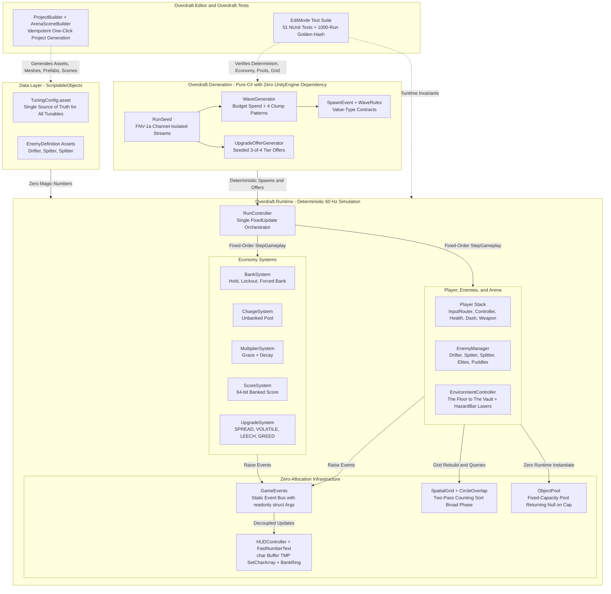
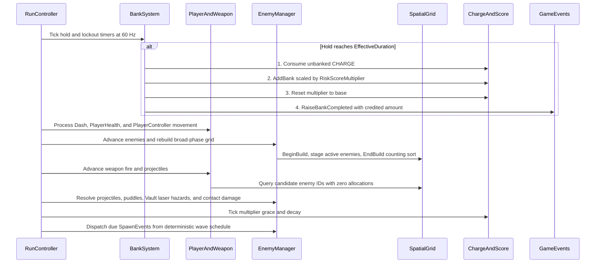
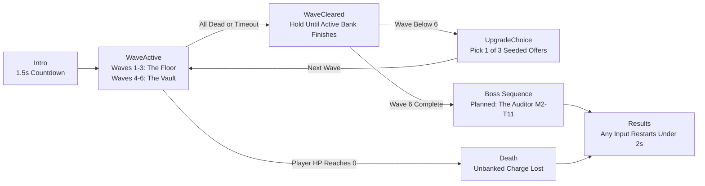

<div align="center">

# OVERDRAFT

**A 6-minute-per-run top-down twin-stick roguelite engineered around push-your-luck score banking.**  
*Zero per-frame GC allocations · Pure-C# cross-platform deterministic generation · Physics-free two-pass spatial hashing*

[](https://unity.com/)
[](https://learn.microsoft.com/en-us/dotnet/csharp/)
[](https://docs.unity3d.com/Packages/com.unity.render-pipelines.universal@14.0/manual/index.html)
[](https://docs.unity3d.com/Packages/com.unity.inputsystem@1.7/manual/index.html)
[](#automated-verification--editmode-test-suite)
[](./LICENSE)

</div>

---

## The Core Mechanic

Your weapon auto-fires continuously. Every enemy killed feeds `enemyValue * MULT` into an unbanked pool called **CHARGE** and raises your **MULT** — which decays if you stop killing.

- **CHARGE is worth zero** when a run ends.
- To convert CHARGE into permanent **SCORE**, you must **hold BANK for 1.2 seconds while completely immobile** (no movement, no dash, half fire rate).
- **Releasing early** cancels cleanly with no penalty and no partial credit.
- **Taking a hit** costs 1 HP, destroys **50% of unbanked CHARGE**, resets MULT to `1.0x`, and — if hit mid-bank — triggers a **2.0s bank lockout**.

Every system in the codebase is engineered around sharpening that 1.2-second risk decision.

---

## System Architecture

OVERDRAFT deliberately avoids heavy frameworks (no DI containers, no ECS/DOTS, no Unity physics). The entire runtime is built on four primitives: **a strict pure-C# generation assembly**, **a single deterministic 60 Hz orchestrator**, **an allocation-free static event bus**, and **bounded object pools**.



---

## 60 Hz Simulation & Bank Completion Pipeline

Unity does not guarantee `FixedUpdate` execution order across `MonoBehaviour` instances. To guarantee deterministic behavior from a seed across Windows and macOS, `RunController.FixedUpdate` drives every gameplay system in an explicit sequence, and `BankSystem.Complete()` enforces a strict 4-step settlement order:



---

## Run State Machine



---

## Core Engineering Highlights

| Pillar | Implementation |
|---|---|
| **Pure-C# Cross-Platform Determinism** | `Overdraft.Generation` has zero `UnityEngine` references (enforced in CI by `verify.sh`). `RunSeed` hashes `(master, channel, index)` via explicit FNV-1a so wave composition, spawn timing, upgrade offers, and hazard rolls stay isolated across future updates. Verified against a committed 1,000-run golden hash (`golden_determinism.txt`). |
| **Zero-Allocation Steady-State Loop** | `FastNumberText` formats 64-bit scores into a reused `char[32]` buffer via `TMP_Text.SetCharArray`. `ObjectPool<T>` pre-warms fixed capacities and returns `null` when exhausted instead of silently growing. `GameEvents` passes `readonly struct` payloads by `in`. |
| **Physics-Free Spatial Collision** | Zero `Rigidbody` or `Collider` components exist in the project. `SpatialGrid` rebuilds every 60 Hz step via a two-pass prefix-sum counting sort into pre-allocated `int[]` arrays (never dropping contacts during dense clumps), paired with XZ squared-distance `CircleOverlap` narrow-phase checks. |
| **Four-Line Asymmetric Upgrade Engine** | `UpgradeSystem` supports 4 lines × 3 tiers (`SPREAD`, `VOLATILE` with per-step chain-depth guards, `LEECH` with bank speed / mid-bank dash refund / completion i-frames, and `GREED` with uncapped multiplier and higher decay/hit risk). |
| **Idempotent One-Click Editor Pipeline** | `Overdraft > Build Project` programmatically generates Linear URP assets, `TuningConfig`, procedural geometry (`PrimitiveMeshFactory`), custom unlit/radial HLSL shaders, New Input System bindings, prefabs, and all 3 wired scenes (`00_Boot`, `01_Menu`, `02_Arena`). |
| **Automated Static Guardrails** | `tools/verify.sh` and `tools/verify.bat` block `UnityEngine` in `Generation/`, `FindObjectOfType`/`GameObject.Find`/`SendMessage`, LINQ in hot folders, runtime `Instantiate` outside pools, `UnityEngine.Random` in generation, and `Camera.main` outside `Awake`/`Start`. |

---

## Implementation Status & Roadmap

| Milestone | Scope | Status |
|---|---|---|
| **M0 — Foundation** | Unity 2022.3 LTS URP setup, asmdefs, `TuningConfig`, `GameEvents`, `ObjectPool<T>`, `SpatialGrid`, `CircleOverlap`, `FastNumberText`, `verify.sh` | **Complete** |
| **M1 — Core Loop** | 60 Hz `RunController`, simultaneous KBM + Gamepad input, auto-fire weapon, 2-charge dash + Perfect Dash, `BankSystem`, `ChargeSystem`, `MultiplierSystem`, `ScoreSystem`, `BankRing`, Hitstop & ScreenShake, Day-3 playtest gate (4/4) | **Complete** |
| **M2 — Waves, Enemies & Upgrades** | Pure-C# `WaveGenerator` (4 clump patterns) & `UpgradeOfferGenerator`, `Drifter` / `Spitter` (pooled puddles) / `Splitter` (splits on death) + Elites, 4×3 upgrade engine (`SPREAD`/`VOLATILE`/`LEECH`/`GREED`), `UpgradeChoiceUI`, `The Floor` → `The Vault` swap + rotating `HazardBar` lasers | **Complete** |
| **M2-T11–T14 — Boss** | **THE AUDITOR** 3-phase boss encounter (laser sweep, Charge-drain audit windows, 6 orbiting fragments + forced free bank) | Planned |
| **M3–M5 — Polish, Meta & Steam** | AudioDirector & dynamic music layers, VFX juice pass, Credit Ranks & JSON save, Steamworks.NET (achievements, leaderboards, Cloud, Rich Presence), signed Windows/macOS builds | Specced in [`docs/`](./docs/) & [`tasks/`](./tasks/) |

---

## Repository Structure

```text
OVERDRAFT_Handover/
├── Assets/
│   ├── _Project/
│   │   ├── Art/
│   │   │   ├── Materials/          # Shared unlit & emissive URP materials
│   │   │   ├── Meshes/             # Procedural vector silhouettes (Disc, Diamond, Triangle, Rings)
│   │   │   ├── Rendering/          # URP pipeline & renderer assets (shadows/lights disabled)
│   │   │   └── Shaders/            # Hand-written HLSL (S_ActorUnlit, S_Additive, S_GridFloor, S_RadialFill)
│   │   ├── Data/                   # TuningConfig.asset & EnemyDefinition ScriptableObjects
│   │   ├── Editor/                 # ProjectBuilder, ArenaSceneBuilder, DataAssetFactory, PrimitiveMeshFactory
│   │   ├── Input/                  # OverdraftControls.inputactions (simultaneous KBM + Gamepad)
│   │   ├── Prefabs/                # Pooled Drifter, Spitter, Splitter, Projectiles, Puddle
│   │   ├── Scenes/                 # 00_Boot.unity, 01_Menu.unity, 02_Arena.unity
│   │   └── Scripts/
│   │       ├── Core/               # RunController, Bootstrap, GameEvents, TuningConfig, EnvironmentController, HazardBar
│   │       ├── Economy/            # BankSystem, ChargeSystem, MultiplierSystem, ScoreSystem, UpgradeSystem
│   │       ├── Enemies/            # EnemyBase, EnemyManager, DrifterAI, SpitterAI, SplitterAI, Puddle, EnemyProjectile
│   │       ├── Generation/         # Pure C# assembly (RunSeed, WaveGenerator, UpgradeOfferGenerator, WaveRules)
│   │       ├── Player/             # PlayerController, PlayerHealth, DashModule, Weapon, PlayerInputRouter
│   │       ├── UI/                 # HUDController, BankRing, FastNumberText, UpgradeChoiceUI
│   │       └── Utility/            # SpatialGrid, ObjectPool, CircleOverlap, DeterministicRandom, Hitstop, ScreenShake
│   └── Tests/EditMode/             # 51 NUnit tests (Economy, Generation + golden hash, Pool, Utility)
├── docs/                           # Tuning bible, architecture, data schemas, Steam spec, art/audio, QA matrix
├── tasks/                          # Milestone task breakdowns (M0–M5)
├── tools/                          # verify.sh (macOS/Linux) & verify.bat (Windows) CI/static gates
├── PRD.md                          # Full Product Requirements Document (FR-100 to FR-546)
├── TEST_RUN.md                     # Clean-machine playtest & profiler verification guide
└── TUNING_LOG.md                   # Playtest gate log and tuning levers
```

---

## Getting Started

### Prerequisites

- **Unity Hub** + **Unity `2022.3.62f3` LTS** (any `2022.3.x` LTS; do not use Unity 6 / 2023.x)
- **Git LFS** (required for binary assets such as fonts/sprites):

```bash
git lfs install
git clone https://github.com/theekshana-sudeepa/OVERDRAFT_Handover.git
cd OVERDRAFT_Handover
```

### Open, Build & Play in Unity

1. Open the cloned repository folder in **Unity Hub** using **Unity 2022.3 LTS**.
2. If prompted to restart for the **New Input System**, choose **Yes**.
3. Import TextMeshPro essentials once: `Window > TextMeshPro > Import TMP Essential Resources`.
4. Run the idempotent project builder (regenerates settings, assets, prefabs, and scenes):
   ```text
   Overdraft > Build Project
   ```
5. Open `Assets/_Project/Scenes/00_Boot.unity` and press **Play**.

### Controls (Live Simultaneously — No Mode Toggle)

| Action | Keyboard + Mouse | Gamepad |
|---|---|---|
| **Move** | `WASD` / Arrow Keys | Left Stick |
| **Aim** | Mouse Cursor (arena-plane ray) | Right Stick |
| **Fire** | Automatic (continuous) | Automatic (continuous) |
| **Dash** | `Shift` / Right Mouse | `RB` / `R1` |
| **BANK (Hold)** | Hold `Space` / Hold Left Mouse | Hold `A` / `Cross` |
| **Restart** | Any Key | Any Face Button |

---

## Automated Verification & EditMode Test Suite

Run static architecture/performance bans anywhere (no Unity required):

```bash
./tools/verify.sh --static-only
```

Run the full CI gate (static bans + batch-mode compile + 51 EditMode NUnit tests):

```bash
# macOS / Linux
UNITY_PATH="/Applications/Unity/Hub/Editor/2022.3.62f3/Unity.app/Contents/MacOS/Unity" ./tools/verify.sh

# Windows
tools\verify.bat
```

| Test Fixture | Coverage |
|---|---|
| `EconomyTests.cs` | Core bank loop, charge halving on hit, multiplier cap & decay grace, bank interrupt lockout, risk scaling, audit drain |
| `GenerationTests.cs` | Same-seed determinism, budget invariants, wave enemy allowlists, 4 clump timing shapes, upgrade offer ordering, 1,000-run golden SHA hash |
| `PoolTests.cs` | Exhaustion returns `null`, double-return safety, zero-allocation `Get`/`Return` |
| `UtilityTests.cs` | Two-pass `SpatialGrid` queries, XZ `CircleOverlap`, `DeterministicRandom`, zero-alloc `FastNumberText.Format` |

---

## License

This project is licensed under the **MIT License** — see the [LICENSE](./LICENSE) file for details.

---

<div align="center">

**Theekshana Sudeepa**  
[LinkedIn](https://www.linkedin.com/in/theekshana-sudeepa/) · [GitHub](https://github.com/theekshana-sudeepa) · [LexoraTech](https://lexoratech.com)

</div>
